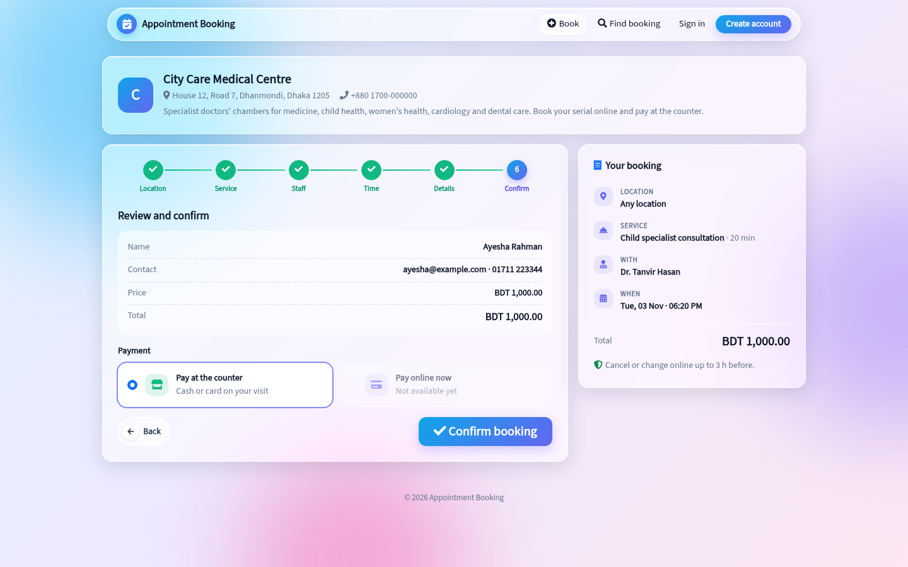

# ABS — Appointment Booking System for Laravel

Multi-business appointment booking for clinics, doctors' chambers, salons, consultants and any service business.
A Laravel package with an admin panel (metheme), a public booking page, a customer panel, and online payments with
**bKash, Nagad, SSLCommerz, Stripe and PayPal**.

> Full illustrated documentation: open `documentation/index.html` in a browser (works offline).



---

## Contents

1. [Features](#features)
2. [Requirements](#requirements)
3. [Installation](#installation)
4. [First configuration](#first-configuration)
5. [Cron and queue](#cron-and-queue)
6. [Payment gateways](#payment-gateways)
7. [URLs](#urls)
8. [Environment keys](#environment-keys)
9. [Roles and permissions](#roles-and-permissions)
10. [Updating](#updating)
11. [Testing](#testing)
12. [Troubleshooting](#troubleshooting)
13. [Support and credits](#support-and-credits)

---

## Features

**Booking engine**
- Several businesses, each with its own branches, timezone (IANA), currency, staff and settings
- Services with duration, buffer before and after, price, tax, deposit and categories
- Staff working hours per weekday, breaks, time off, business holidays
- Live free-slot search. One staff member can never be double-booked: rows are locked inside a transaction (verified with 10 parallel processes)
- Daylight-saving-time safe: stored in UTC, shown in the business timezone
- Booking window (minimum notice, maximum days ahead), cancellation and reschedule cut-offs
- Instant confirmation or owner approval
- Status workflow: pending → confirmed → checked in → in progress → completed / no-show / cancelled / rejected, with time rules and full history

**Admin panel** (metheme)
- Dashboard: today's queue, upcoming bookings, revenue
- Calendar: one colour per staff member, filters, drag-and-drop reschedule, quick actions, click an empty slot to book
- Appointment list with search and filters, CSV export
- Manual booking for walk-ins and phone calls
- Appointment detail: status actions, payments, refunds, discount, invoice, prescription and report upload
- Reports: bookings, revenue, staff utilisation, cancellations, with CSV export
- Diagnostics page (queue, scheduler, mail, storage checks)
- Role-based access: Owner, Manager, Receptionist, Staff (a staff member sees only their own appointments)

**Public site and customer panel** (glass theme, mobile first)
- 6-step booking wizard: location → service → staff (or "any available") → time → details → confirm
- Find a booking with booking number + phone number (optional SMS one-time code)
- Customer account: register, sign in, booking history, booking detail, profile
- Reschedule and cancel online, within the business's rules
- Printable booking slip
- Download prescriptions and reports that the clinic shares (private storage, signed links)
- Customers never reach the admin panel

**Payments**
- Pay at the counter, partial payments, deposits, cash and bank transfer recorded by staff
- Online: **bKash** (tokenized checkout), **Nagad**, **SSLCommerz**, **Stripe Checkout**, **PayPal**
- Each business enters its own merchant keys in the admin panel (stored encrypted), sandbox or live, with a "Test connection" button
- Payment is confirmed by asking the gateway server-side, never from the browser redirect
- Refunds through the gateway API, or recorded as done in the merchant portal
- Invoices with sequential numbers

**Notifications**
- E-mail on booking, confirmation, reschedule, cancellation and payment, plus reminders before the appointment
- Optional SMS through metheme's SMS gateway
- Each message is sent once (deduplicated)

**Quality**
- 184 automated tests (PHPUnit, MySQL), including a parallel double-booking test
- Security headers, rate limits, signed URLs, CSRF, XSS-escaped output, encrypted gateway credentials

---

## Requirements

| | |
|---|---|
| PHP | 8.3 or newer, with `pdo_mysql`, `mbstring`, `openssl`, `json`, `fileinfo`, `zip` (`intl` recommended) |
| Database | MySQL 8.0+ or MariaDB 10.6+ |
| Laravel | 13.x |
| Packages | `mestiaque/metheme` (admin theme, users, roles, settings), `livewire/livewire` ^4.4 (installed automatically) |
| Server | Composer 2, a cron entry, a queue worker, HTTPS in production |

---

## Installation

### Option A: the ready-made application (recommended)

The download contains a complete Laravel application (`app/`) with both packages already wired.

```bash
cd app
cp .env.example .env
composer install --no-dev --optimize-autoloader
php artisan key:generate
```

Edit `.env`:

```env
APP_NAME="Appointment Booking"
APP_URL=https://booking.example.com     # must be the real address; signed links depend on it
DB_DATABASE=abs
DB_USERNAME=...
DB_PASSWORD=...
QUEUE_CONNECTION=database
METHEME_HOME_ROUTE=abs.dashboard
```

Keep `timezone` in `config/app.php` as `UTC`. Each business has its own timezone.

Then:

```bash
php artisan migrate --force
php artisan db:seed --force                       # metheme base data (admin user, roles, settings)
php artisan vendor:publish --tag=metheme-assets
php artisan abs:install                           # booking roles, requirement check
php artisan abs:install --clinic-demo             # optional: a clinic with 6 doctors and sample bookings
php artisan storage:link
php artisan optimize
```

Point the web server's document root to `app/public`.

### Option B: add the package to an existing metheme application

```bash
composer config repositories.abs path ../abs     # or your private repository
composer require mestiaque/abs:@dev
php artisan abs:install
```

`abs:install` only runs pending migrations and creates roles. It never deletes data, and it is safe to run again.
`--demo` (generic) and `--clinic-demo` add sample data only when no business exists yet.

### Sign in

Open `https://your-domain/login`. The metheme seed creates `admin@mestiaque.com` / `p@ssword`.
**Change this password (or delete the account) immediately.** It is public.

---

## First configuration

1. **Users & Roles → Users**: create staff accounts with the *Booking Owner*, *Booking Receptionist* or *Booking Staff* role.
2. **Booking → Business → Businesses → Add**: name, slug, timezone, currency, contact details.
3. **Business → Branches** (optional): locations.
4. **Catalog & Staff → Categories, Services**: duration, price, buffers.
5. **Catalog & Staff → Staff**: add each doctor or staff member, assign services, link a user account, then open **Hours** and set the weekly schedule, breaks and time off.
6. **Business → Booking Settings**: approval mode, slot step, notice, booking window, cancellation rules, payment mode.
7. **Business → Payment Gateways** (optional): enter merchant keys, then *Test connection*.
8. **Configuration → Mail Configuration** (metheme): SMTP. Until it is set, mail goes to the log file.
9. Share the booking link: `https://your-domain/book/{business-slug}`.

---

## Cron and queue

E-mails, reminders and expiry of unpaid holds need both of these.

```cron
* * * * * cd /path/to/app && php artisan schedule:run >> /dev/null 2>&1
```

Supervisor (`/etc/supervisor/conf.d/abs-worker.conf`):

```ini
[program:abs-worker]
command=php /path/to/app/artisan queue:work --sleep=3 --tries=3 --max-time=3600
autostart=true
autorestart=true
user=www-data
numprocs=1
stopwaitsecs=3600
```

The scheduler runs `abs:send-reminders` and `abs:expire-holds`. After each deploy, run `php artisan queue:restart`.

---

## Payment gateways

Go to **Admin → Business → Payment Gateways**, choose the gateway, enter the keys, pick *Sandbox* or *Live*, turn it on and press **Test connection**.
Then set **Booking Settings → Payment mode** to *online optional*, *full payment* or *deposit*.

| Gateway | You need | URL to register at the gateway |
|---|---|---|
| bKash | App key, App secret, Username, Password | none (callback is automatic) |
| Nagad | Merchant ID, Merchant private key, Nagad public key | none |
| SSLCommerz | Store ID, Store password | IPN URL shown on the page |
| Stripe | Secret key, Webhook signing secret | `https://your-domain/abs/webhooks/stripe/{business-id}` |
| PayPal | Client ID, Secret, Webhook ID | `https://your-domain/abs/webhooks/paypal/{business-id}` |

- bKash and Nagad accept BDT only.
- Secrets are encrypted with `APP_KEY` and never shown again. Leave a field empty to keep the saved value.
- **If you change `APP_KEY`, saved gateway keys cannot be read and must be entered again.**
- A payment is marked paid only after the server asks the gateway and the amount and currency match.
- Nagad refunds are done in the Nagad merchant portal, then recorded with "already refunded from the merchant portal".

The gateway code has automated tests against simulated responses. **Run a sandbox payment and refund with your own merchant account before going live.**

Details: `docs/PAYMENT_INTEGRATION.md`.

---

## URLs

| URL | Who | What |
|---|---|---|
| `/` or `/book` | everyone | list of businesses |
| `/book/{slug}` | everyone | booking wizard |
| `/book/find` | everyone | find a booking by number + phone |
| `/account/login`, `/account/register` | customers | customer sign-in and sign-up |
| `/account` | customers | booking history |
| `/login` | staff | admin sign-in |
| `/admin/booking` | staff | admin dashboard |

The segments `booking`, `book` and `account` can be changed with the keys below.

---

## Environment keys

| Key | Default | Meaning |
|---|---|---|
| `ABS_ADMIN_PATH` | `booking` | admin URL segment (`/admin/booking`) |
| `ABS_PUBLIC_PATH` | `book` | public URL segment |
| `ABS_ACCOUNT_PATH` | `account` | customer panel segment |
| `ABS_DEFAULT_TIMEZONE` | `UTC` | default for a new business |
| `ABS_DEFAULT_CURRENCY` | `USD` | default for a new business |
| `ABS_SMS_NOTIFICATIONS` | `false` | also send SMS through metheme |
| `ABS_RATE_LIMIT_BOOKING` | `10` | bookings per IP per minute |
| `ABS_RATE_LIMIT_SLOTS` | `60` | slot searches per IP per minute |
| `ABS_PAYMENT_GATEWAY`, `STRIPE_*`, `PAYPAL_*` | empty | optional, older `.env` setup for Stripe/PayPal; the admin page is preferred |

---

## Roles and permissions

| Role | Can do |
|---|---|
| Booking Owner | everything in their businesses, including settings, gateways, refunds and reports |
| Manager (membership) | daily operations and reports, no business settings |
| Booking Receptionist | book, reschedule, check in, take payments |
| Booking Staff | see and update only their own appointments |
| Customer | customer panel only; never the admin panel |

A user must have both the metheme permission and a membership in the business. See `docs/AUTHORIZATION_MATRIX.md`.

---

## Updating

```bash
php artisan down
# replace the files with the new version (keep .env and storage/)
composer install --no-dev --optimize-autoloader
php artisan migrate --force
php artisan abs:install
php artisan optimize
php artisan queue:restart
php artisan up
```

Back up the database before every update. See `docs/CHANGELOG.md`.

---

## Testing

```bash
cd app
php artisan test --compact
```

The tests need a separate, empty MySQL database (`abs_testing` in `phpunit.xml`). **Never point the tests at your live database.**

---

## Troubleshooting

| Problem | Fix |
|---|---|
| "No free time" on every day | Staff has no working hours, the service is not assigned to the staff member, or the booking window is too short |
| E-mails are not sent | Start the queue worker and set SMTP in Mail Configuration |
| Reminders are not sent | The cron entry is missing |
| "Invalid signature" on links | `APP_URL` does not match the address in the browser (http/https, www) |
| Page looks unstyled | `php artisan vendor:publish --tag=metheme-assets`, then clear the browser cache |
| Gateway is not offered | Not switched on, currency is not BDT (bKash/Nagad), or the payment mode is "pay later" |
| Uploaded documents cannot be opened | Check the permissions of `storage/` |

More: `docs/TROUBLESHOOTING.md`. The admin **Diagnostics** page checks the queue, scheduler, mail and storage.

---

## Support and credits

- Author: M. Estiaque Ahmed Khan — https://mestiaque.com — info@mestiaque.com
- Built with Laravel, Livewire, Bootstrap 5, FullCalendar (MIT), Luxon (MIT), Font Awesome Free (icons CC BY 4.0, code MIT)
- Developer documentation is in `docs/`: architecture, booking engine, state machine, database schema, payments, deployment
