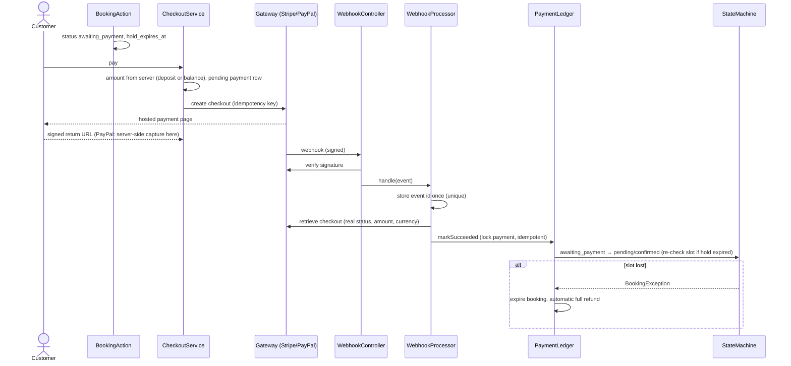

# Sequence Plan

Two parts: **A** — runtime sequence diagrams of the main flows; **B** — the delivery sequence (what was built in which order, and what comes next).

## A. Runtime sequences

### A1. Online booking (pay later / instant)

```mermaid
sequenceDiagram
    actor C as Customer
    participant W as BookingWizard (Livewire)
    participant F as SlotFinder
    participant A as AppointmentBookingAction
    participant DB as MySQL
    participant N as AppointmentNotifier / Queue
    C->>W: choose branch, service, staff, date
    W->>F: times(date) (advisory)
    F->>DB: schedules, breaks, time off, holidays, blocking appts
    F-->>W: free slots
    C->>W: pick slot, enter details, confirm
    W->>A: execute(BookingRequest)
    A->>A: eligibility (ids belong to business), booking window
    A->>DB: BEGIN; SELECT staff FOR UPDATE
    A->>DB: SELECT conflicting appts FOR UPDATE (re-check)
    alt free
        A->>DB: INSERT appointment, item snapshot, status history; COMMIT
        A->>N: afterCommit → queue mails
        W-->>C: redirect to signed manage link
    else taken
        A->>DB: ROLLBACK
        W-->>C: "time no longer available", back to time step
    end
```

### A2. Online payment (Stripe/PayPal) and webhook



### A3. Calendar drag-and-drop reschedule

```mermaid
sequenceDiagram
    actor R as Receptionist
    participant FC as FullCalendar
    participant CC as CalendarController::move
    participant RA as AppointmentReschedulingAction
    participant DB as MySQL
    R->>FC: drag event to new time
    FC->>CC: POST start (CSRF)
    CC->>CC: abs.can:abs_appointment.reschedule; load via business
    CC->>RA: execute(start, staff)
    RA->>DB: lock staff rows (id order), lock appointment
    RA->>DB: availability (ignoring itself)
    alt free
        RA->>DB: history + update row; COMMIT
        CC-->>FC: 200 message → refetch
    else conflict
        CC-->>FC: 422 message → revert, toast
    end
```

### A4. Scheduled jobs

```mermaid
sequenceDiagram
    participant Cron as schedule:run
    participant E as abs:expire-holds
    participant R as abs:send-reminders
    Cron->>E: every minute
    E->>E: awaiting_payment with expired hold → expired; cancel pending checkout
    Cron->>R: every 5 minutes
    R->>R: confirmed, starts within reminder window, reminder_sent_at IS NULL
    R->>R: conditional UPDATE claims row → queue reminder (dedupe key)
```

## B. Delivery sequence

| Step | Phase | Delivered | Status |
|---|---|---|---|
| 1 | 0 Audit | PROJECT_AUDIT, IMPLEMENTATION_PLAN; kazitds removed; DBs `abs`/`abs_testing`; Livewire approved | Done |
| 2 | 1 Foundation | businesses, members, branches, settings, `BusinessAccess`, `CurrentBusiness`, middleware, sidebar, permissions | Done |
| 3 | 2 Catalog | categories, services, staff, overrides, schedules, breaks, time off, holidays | Done |
| 4 | 3 Engine | Interval, LocalTime, Currency, availability, slots, pricing, booking/reschedule/cancel actions, state machine, concurrency test | Done |
| 5 | 4 Appointments | public wizard, manage link, admin list and detail, manual booking | Done |
| 6 | 5 Payments | contract, cash, Stripe, ledger, refunds, invoices, webhooks | Done |
| 7 | 6 Notifications | queued mails, dedupe log, reminders, optional SMS | Done |
| 8 | 7 Reports | dashboard, reports, CSV, diagnostics | Done |
| 9 | 8 Hardening | tests, docs, demo data, installer, responsive pass | Done |
| 10 | rc2 | PayPal, discount, customer history, time guards, `/` home | Done |
| 11 | rc3 | clinic demo data, calendar redesign, business switcher fix, `CurrentBusiness` fix | Done |
| 12 | Next | live Stripe/PayPal sandbox runs | Needs credentials |
| 13 | Next | real-device QA (Android/iOS browsers) | Open |
| 14 | Later | coupons, recurring appointments, multi-service cart, waiting list, local gateways (bKash/SSLCommerz) | Not started |
| 15 | Release | CodeCanyon package, version tag, changelog | Open |
