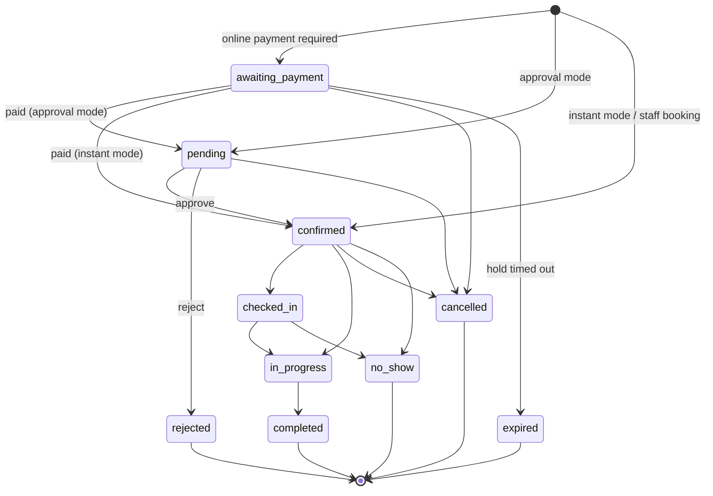

# Appointment State Machine

Source of truth: `ME\Abs\Enums\AppointmentStatus::allowedTransitions()`. Every change goes through `ME\Abs\Actions\AppointmentStateMachine::transition()`. `status` is not mass-assignable.

## Diagram

## Transition table

| From | To | Who | Guards | Side effects |
|---|---|---|---|---|
| (new) | awaiting_payment | customer | payment mode requires online payment and amount > 0 | `hold_expires_at` = now + hold minutes |
| (new) | pending | customer | approval mode | mail: booking received (customer and business) |
| (new) | confirmed | customer / staff | instant mode, or staff booking | mail: booking confirmed |
| awaiting_payment | pending / confirmed | system | verified payment; **slot re-checked if the hold expired** | if the slot is gone → `expired` plus automatic full refund |
| awaiting_payment | expired | system (`abs:expire-holds`) | `hold_expires_at` passed | pending checkout cancelled |
| pending | confirmed | `abs_appointment.approve` | slot re-checked when pending does not hold slots | mail: approved |
| pending | rejected | `abs_appointment.approve` | — | reason stored; online payments refunded automatically; mail |
| pending / confirmed / awaiting_payment | cancelled | staff with `abs_appointment.cancel`, or customer within policy | customer: setting on and before the notice limit | reason stored; no automatic refund; mail |
| confirmed | checked_in / in_progress | `abs_appointment.status` | from the appointment's local day | — |
| checked_in | in_progress | `abs_appointment.status` | from the appointment's local day | — |
| confirmed / checked_in | no_show | `abs_appointment.status` | only after the start time | — |
| in_progress | completed | `abs_appointment.status` | only after the start time | — |

Each transition locks the staff row, then the appointment (the same order as booking, so no deadlocks). It writes `abs_appointment_status_histories` (from, to, actor user, actor type `customer|staff|system`, reason) and sends notifications only after commit.

## Blocking statuses

`confirmed`, `checked_in`, `in_progress`, `completed` and `no_show` always occupy their time. `pending` occupies it when `pending_blocks_slot` is on. `awaiting_payment` occupies it until the hold expires. `rejected`, `cancelled` and `expired` never do.

## Payment status (separate field)

`unpaid → partially_paid → paid → partially_refunded → refunded`. This is not a state machine. `PaymentLedger::recalculate()` derives it each time from the payment rows. Payment never changes the appointment status, except `awaiting_payment` → next state as shown above.

## Refund status

`requested → pending → completed | failed`. It is monotonic: completed and failed are final, and money is applied once, on completion.
